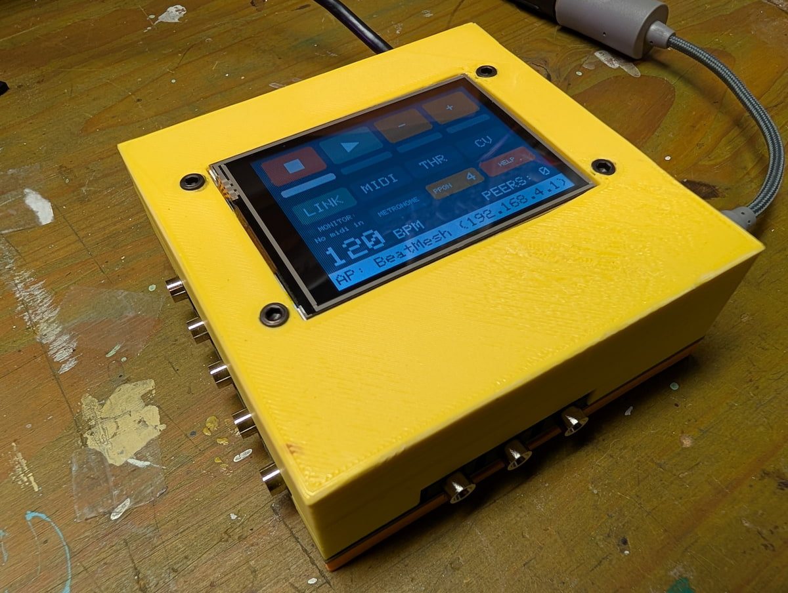
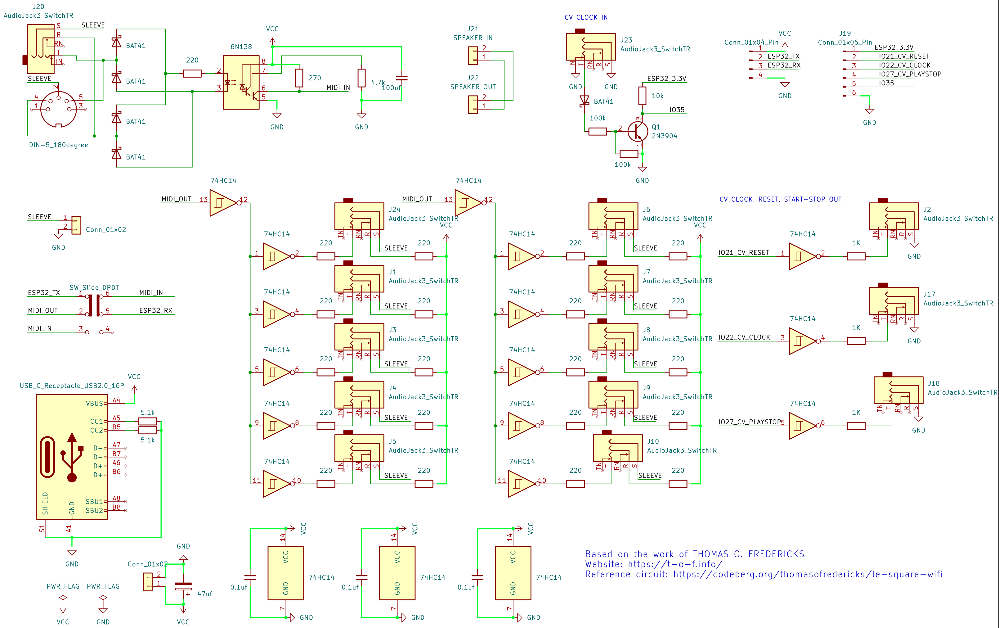
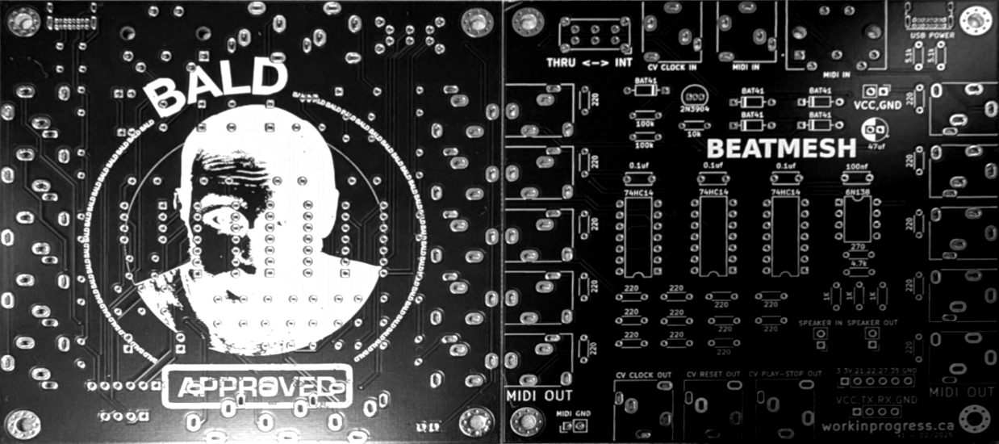
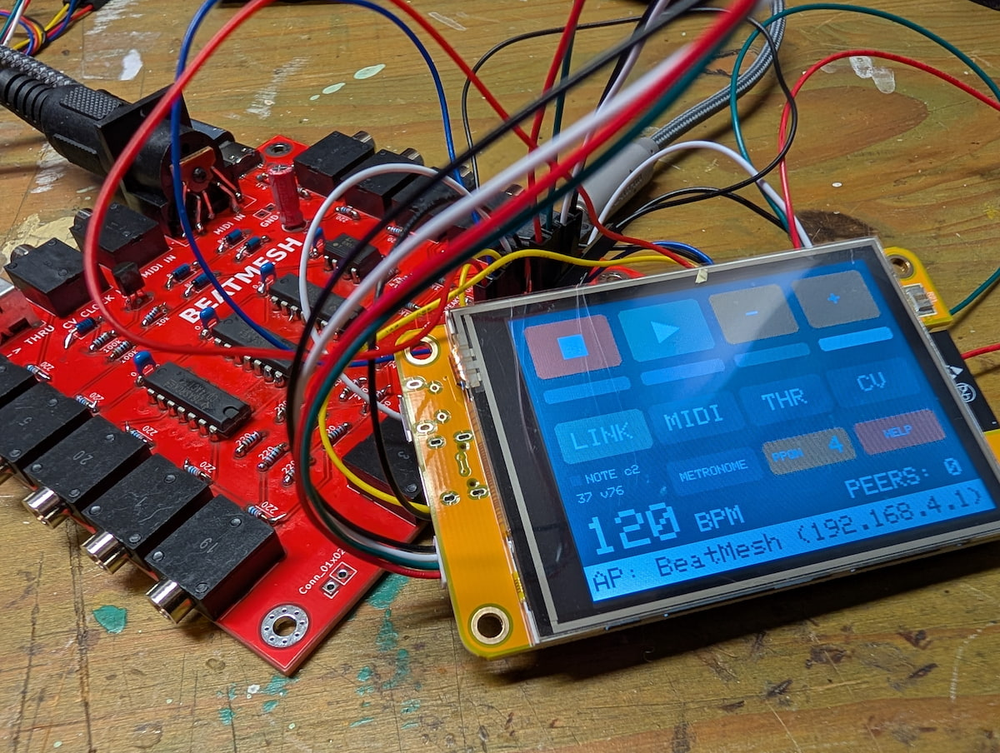
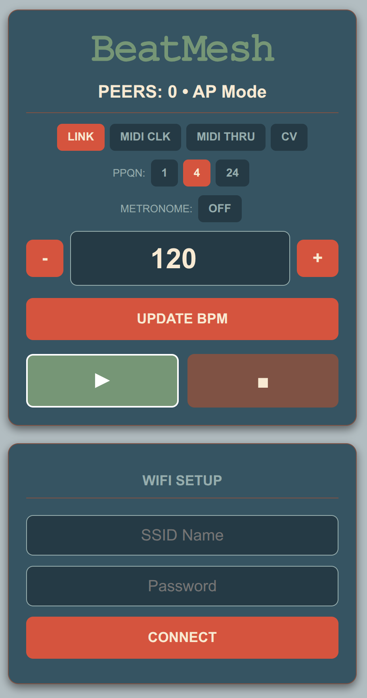
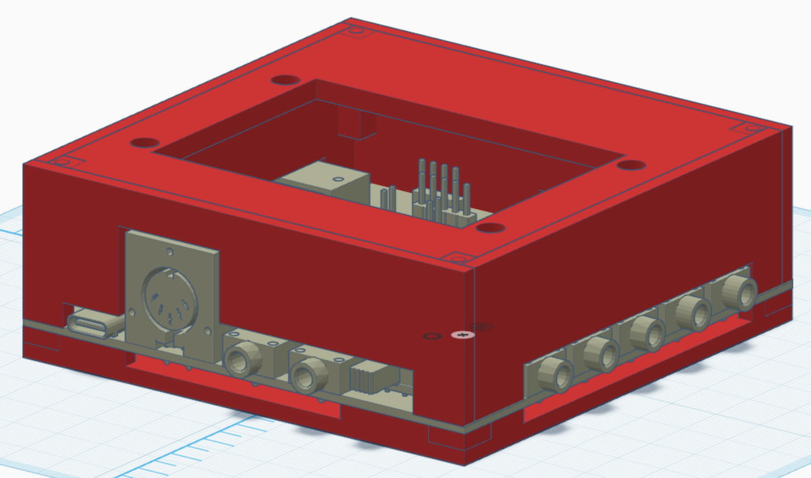

# BeatMesh

A module to synchronize via Ableton Link, MIDI, or CV clock. 

Built with PlatformIO and the ESP-IDF framework (espressif32), BeatMesh acts as a hub to keep your hardware and software locked in time.

## 🚀 Features

- **10x MIDI Out ports**
- **Flexible Routing:** Send raw MIDI to all 10 outputs OR filter to keep only the MIDI clock.
- **CV Integration:** CV clock and reset outputs.
- **Ableton Link:** Synchronize seamlessly over WiFi.
- **Ignore Stop:** Jam-proof mode. Stop messages from Link peers, MIDI in or CV in are refused; only BeatMesh itself can stop the clock.
- **MIDI Metronome:** Clock-synced click on the MIDI outputs (note 72 on beat 1, 64 on beats 2-4, channel 1 or 10).
- **Tuner:** One long open-string note on MIDI channel 1, note on at the downbeat of every bar and retriggered at the next one, for tuning by ear. One button cycles through the six guitar strings (E2 A2 D3 G3 B3 E4).
- **Random MIDI (debug mode):** Random pentatonic notes on channels 1-6, random-walk CCs, and a simple four-on-the-floor drum pattern on channel 10, all locked to the clock.
- **OTA Firmware Updates:** Upload new firmware (`.bin`) directly from the web portal, no cable needed.
- **Easy Soldering:** All through-hole components (except USB-C, see below*), beginner-friendly assembly.
- **Easy to Print:** Two-piece 3D-printed case (top and bottom STL), no supports needed, held together with M3 screws.



[](board/schematic.pdf)









---

## 🎛️ Custom PCB (KiCad)

The repository includes a production-ready printed circuit board designed in **KiCad 10**. You can find the source files (`.kicad_sch` and `.kicad_pcb`) in the `board/` directory.

<!-- V1 PCB errata (fixed on V2 boards):
> ⚠️ **V1 PCB Errata:** The 2-pin power connector near the USB-C port has its silkscreen polarity printed incorrectly. The actual pinout is **GND, VCC** (not VCC, GND as silkscreened). Wire accordingly to avoid damage.
-->

### Power & USB-C Assembly Notes*

The board only draws 5V power from USB-C; no data lines are used. Two shortcuts make assembly easier:

- **\*Skip the USB-C connector if you are new to soldering.** It is the only surface-mount part on the board; its pins are fine-pitch and tricky to solder by hand. Instead, cut an old USB cable, and solder its **VCC (red)** and **GND (black)** wires directly to the 2-pin power connector pads next to the USB-C footprint. Mind the polarity marked on the silkscreen.
- **The 5.1kΩ resistors (R2, R3) are only needed for USB-C to USB-C.** They are the CC pull-downs that tell a USB-C power adapter or USB-C host to turn on 5V. If you power the board with a **USB-A to USB-C** cable (phone charger, computer port, power bank), 5V is always present on VBUS and R2/R3 can be left unpopulated. In that case only the **VBUS and GND** pins of the USB-C connector need to be soldered.

### Hardware Design Highlights:
- **Form Factor:** 100mm x 100mm, 2-layer board (optimized for low-cost fabrication).
- **MIDI Input:** Fully opto-isolated using a **6N138** optocoupler. The circuit is properly level-shifted to send safe 3.3V logic to the ESP32, while powering the optocoupler with 5V for fast, reliable data transmission.
- **10x MIDI Outputs:** Buffered (using 2N3904 NPN transistors) and split to drive up to 10 distinct devices simultaneously without signal degradation. Designed with space-saving 3.5mm TRS jacks (SJ1-3515N).
- **CV / Sync Out:** Capable of sending analog clock, reset, and play/stop signals to Eurorack/modular gear. Includes **BAT41** Schottky diodes for signal protection.
- **CYD Integration:** Designed to interface cleanly with the Cheap Yellow Display (ESP32-2432S028R) ecosystem via standard 2.54mm pin headers.
- **Power Delivery:** Robust decoupling with 100nF ceramics and 47µF (25V) electrolytics to keep clock and CV paths stable and noise-free.

---

## 🖨️ 3D Printed Case

The case is two pieces, in the `3dprint/` folder:

- `3dprint/BeatMeshV2 - TOP.stl`
- `3dprint/BeatMeshV2 - BOTTOM.stl`

Both print flat on the bed with no supports. Any PLA or PETG works.

Hardware:

- **4x M3 x 30 mm** screws: hold the top and bottom pieces together, screwing straight through both boards.
- **4x M3 x 12 mm** screws with nuts: mount the CYD to the top piece.

---

## 🔊 Optional Metronome (Speaker)

The firmware has a built-in metronome (1200 Hz click on beat 1, 800 Hz on beats 2-4) that plays through the CYD's onboard audio amplifier on GPIO 26. It is **disabled by default** because most builds have no speaker, and the METRONOME button is hidden from the TFT and the web UI.

To use it:

1. Wire the CYD speaker connector to the **SPEAKER IN** header on the BeatMesh board.
2. Connect a small speaker (8 Ω, 0.5-1 W) to the **SPEAKER OUT** header on the BeatMesh board.
3. In `src/main.cpp`, change `#define BEATMESH_METRONOME 0` to `1`.
4. Recompile and flash (`pio run -t upload`, or upload the new `.bin` from the web portal). The metronome code is compiled out, so a rebuild is required; toggling it is not a runtime setting.

The METRONOME button then appears on the main screen (row 2, left of PPQN) and on the web page.

---

## 💻 Installation & Dependencies

> Built with PlatformIO platform `espressif32@6.12.0`, framework `espidf` (ESP-IDF v5.5.0).

External components live under `components/` as git submodules pinned to the versions used in this project:

| Submodule | Upstream | Pinned at |
|---|---|---|
| `components/asio/asio` | [chriskohlhoff/asio](https://github.com/chriskohlhoff/asio) | `asio-1-32-0` |
| `components/esp_abl_link` | [docwilco/esp_abl_link](https://github.com/docwilco/esp_abl_link) | `v3.1.5-1` |
| `components/esp_abl_link/vendor/ableton-link` | [Ableton/link](https://github.com/Ableton/link) | `Link-3.1.5` |
| `components/LovyanGFX` | [lovyan03/LovyanGFX](https://github.com/lovyan03/LovyanGFX) | `1.2.19` |

### Cloning

```bash
git clone --recurse-submodules https://github.com/patricksebastien/BeatMesh.git
```

If you already cloned without `--recurse-submodules`:

```bash
git submodule update --init --recursive
```

> Use `git config --global url."https://github.com/".insteadOf git@github.com:` if you don't have ssh key configured.

### ASIO Patch (Required)
To prevent the ESP32 from rebooting during transient network errors (e.g., `send_to ENOMEM`), ASIO needs a small patch. Link recovers from packet loss gracefully, so we do not want `std::terminate` to abort the program.

Apply the patch shipped in this repo:

```bash
git -C components/asio/asio apply ../../../patches/asio-esp32-rethrow-fix.patch
```

---

## ⚙️ Configuration Files

### 1. `platformio.ini`
Add the following to your environment configuration to ensure correct serial speeds, flash sizing, the OTA partition table, and ASIO compatibility:

```ini
[env:esp32dev]
platform = espressif32@6.12.0
board = esp32dev
framework = espidf
monitor_speed = 115200
board_upload.flash_size = 4MB
board_build.partitions = ota_4mb.csv    ; two ~1.94MB OTA slots (web firmware update)

extra_scripts = pre:git_version.py      ; injects GIT_VERSION (short commit hash) into the build

build_flags =
    -fexceptions
    -D ASIO_STANDALONE
    -D ASIO_NO_TYPEID
```

### 2. `ota_4mb.csv` (Partition Table)
Create this file in the root directory. Link and LovyanGFX make the binary quite large, so the default partition table is too small. Two ~1.94 MB app slots give room for the OTA web update while still fitting the ~1.4 MB image.

```csv
# Name,   Type, SubType, Offset,   Size, Flags
nvs,      data, nvs,     0x9000,   0x4000,
otadata,  data, ota,     0xd000,   0x2000,
phy_init, data, phy,     0xf000,   0x1000,
ota_0,    app,  ota_0,   0x10000,  0x1F0000,
ota_1,    app,  ota_1,   0x200000, 0x1F0000,
```

Changing the partition table requires one flash over USB; OTA works from then on.

### 3. `sdkconfig.defaults`
Create this file in the root directory. The essential settings are below; the full file in the repo also tunes WiFi buffers, LWIP, UDP mailboxes and TCP timeouts for up to 10 Link peers plus the web portal.

```ini
# Flash Size & Speed (CYD has a 4MB Flash chip)
CONFIG_ESPTOOLPY_FLASHSIZE_4MB=y
CONFIG_ESPTOOLPY_FLASHFREQ_80M=y
CONFIG_ESPTOOLPY_FLASHMODE_QIO=y

# C++ Exceptions (Required for ASIO/Link)
CONFIG_COMPILER_CXX_EXCEPTIONS=y
CONFIG_COMPILER_CXX_RTTI=y

# Partition Table Layout (OTA, see ota_4mb.csv above)
CONFIG_PARTITION_TABLE_CUSTOM=y
CONFIG_PARTITION_TABLE_CUSTOM_FILENAME="ota_4mb.csv"
CONFIG_BOOTLOADER_APP_ROLLBACK_ENABLE=y

# CPU Frequency (Ensure Link timing on Core 1 and Display/WiFi on Core 0 run smoothly)
CONFIG_ESP_DEFAULT_CPU_FREQ_MHZ_240=y
CONFIG_ESP_DEFAULT_CPU_FREQ_MHZ=240

# Link tasks on Core 1 (WiFi stays on Core 0)
CONFIG_LINK_ESP_TASK_CORE_ID=1

# LWIP (Networking for Link - Multicast support is crucial)
CONFIG_LWIP_MAX_SOCKETS=32
CONFIG_LWIP_IGMP=y
CONFIG_LWIP_SO_REUSE=y

# Disable Bluetooth (WiFi only)
CONFIG_BT_ENABLED=n
```

### 4. `src/CMakeLists.txt`
Include the necessary libraries via `REQUIRES` so ESP-IDF links them properly:

```cmake
idf_component_register(SRCS "main.cpp"
                    INCLUDE_DIRS "."
                    REQUIRES LovyanGFX esp_http_server nvs_flash esp_wifi esp_event esp_abl_link app_update)
```
